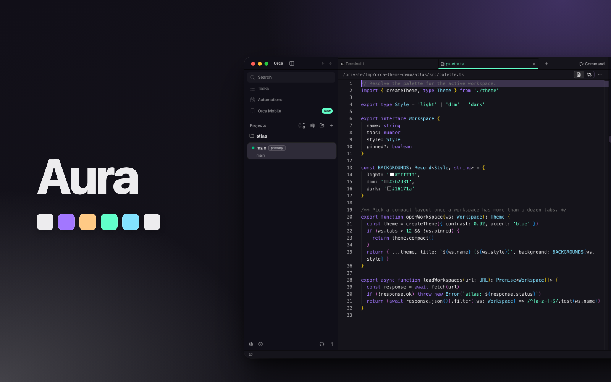
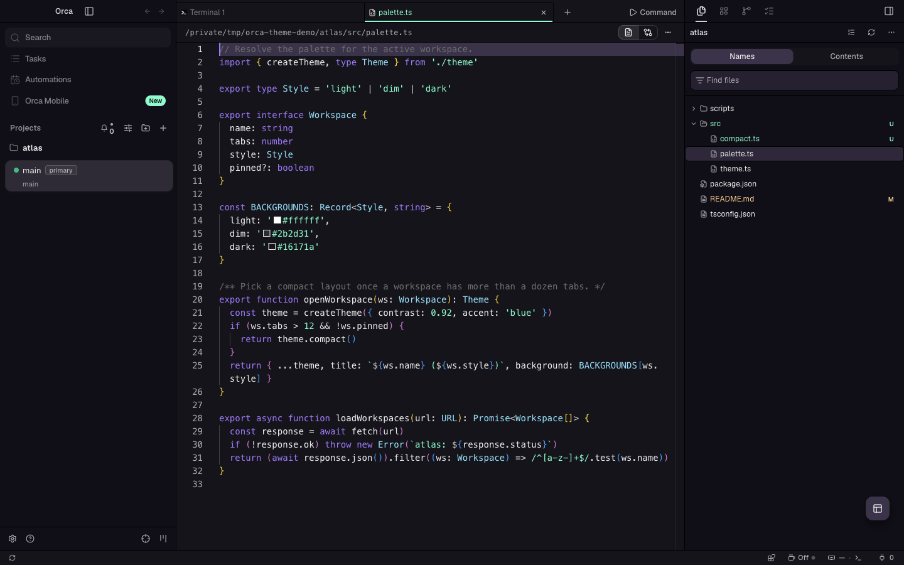
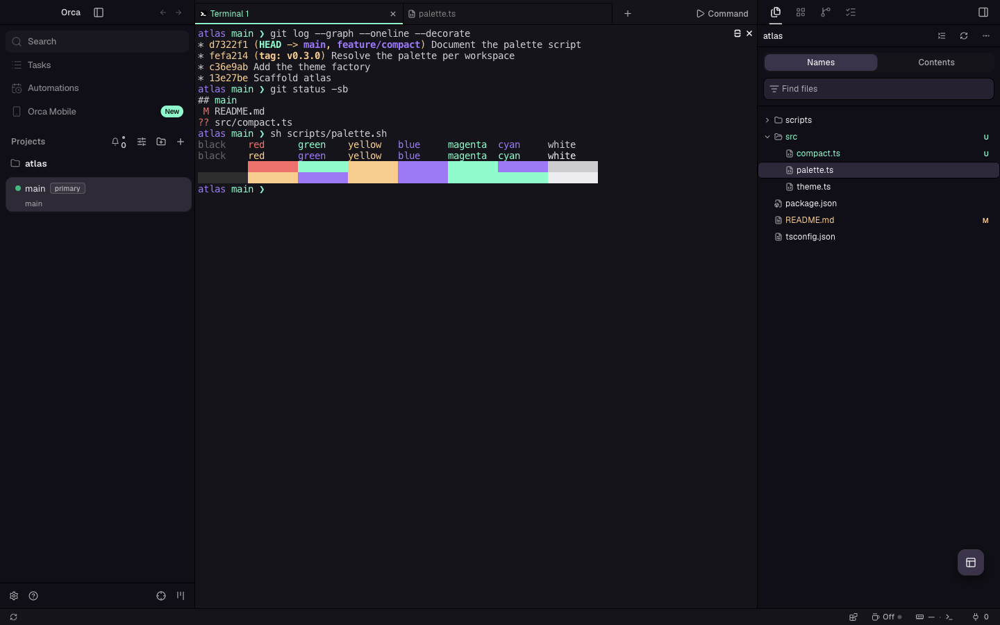

# Aura for Orca

The Aura Dark style of [Aura Theme](https://github.com/daltonmenezes/aura-theme) as app, editor
and terminal themes for [Orca](https://github.com/stablyai/orca). It is built from aura-theme
commit
[`20924aa`](https://github.com/daltonmenezes/aura-theme/commit/20924aa0a43975420edd0e0b2f919e07a3eff9c9)
(VS Code port version 2.1.2). Aura Theme is designed by
[Dalton Menezes](https://github.com/daltonmenezes).



## The theme

Aura Dark is a dark theme on a near-black violet `#15141b`, with purple `#a277ff` and green
`#61ffca` as the accents. It themes the app, the editor's syntax colors and the terminal's 16 ANSI
colors.

| Editor | Terminal |
| --- | --- |
|  |  |

## Install

Find **Aura for Orca** in Orca's plugin directory and install it. It needs Orca 1.4.246 or later.
To install it from this repository instead:

1. In Orca, open Settings → Plugins.
2. Open **Add plugin** → **From a Git URL…**.
3. Enter `https://github.com/vale-c/orca-aura.git` with ref `main`, and install
   **Aura for Orca**.
4. In Settings → Appearance, pick **Aura Dark** as the dark theme. Pick the Aura Dark terminal
   theme in the terminal settings.

To try a local copy instead, use **Add plugin** → **From a folder…** and select the root folder
of this repository. Orca reloads the theme when the files change.

## How the colors map

Aura generates its VS Code themes from code: `src/core/colors/schemes` holds the palette
(`accent0` to `accent39`), and the VS Code port (`src/ports/vscode`) fills a theme template with
it. `scripts/aura-palette.json` holds the dark palette and the Aura Dark theme that upstream's own
port makes from it. The vendor script checks that this theme equals
`packages/vscode/themes/aura-dark-color-theme.json` at the pinned commit.

Each Orca token takes the VS Code color that paints the same part of the window. For example,
`--background` is `editor.background`, `--sidebar` is `sideBar.background`, `--popover` is
`dropdown.background`, `--tab-active-indicator` is `tab.activeBorderTop`, and
`--diff-added-background` is `diffEditor.insertedTextBackground`. Each syntax rule takes the color
and font style of upstream's token rule for one named scope. `scripts/build.mjs` lists every
mapping, and `scripts/derived-tokens.json` lists the tokens left to Orca with the reason for each.

## Differences from upstream

Orca drops an app text color under 4.5:1 contrast with its surface, and a git status color under
3:1 on the sidebar. These colors are changed in OKLCH lightness only, keeping chroma and hue, by
the smallest step that passes:

| Color | Used for | Upstream | Shipped |
| --- | --- | --- | --- |
| `tab.inactiveForeground` | Inactive tab text (3.54:1 upstream) | `#6d6d6d` | `#7f7f7f` |
| `gitDecoration.ignoredResourceForeground` | Git-ignored files (2.25:1 upstream) | `#4d4d4d` | `#616161` |

Orca requires opaque text and surfaces, so the fully transparent active tab is painted onto the
tab bar, as VS Code shows it. The terminal selection is painted onto the terminal background. The
diff tints and the split divider hover keep upstream's alpha.

Other differences:

- Focus rings, the editor cursor and the editor selection use `editorCursor.foreground`, the
  purple `#a277ff`. Orca draws the cursor and a 30% selection from the ring color, so the cursor
  matches upstream and the selection is a brighter purple than upstream's `#3d375e7f`. Upstream's
  `focusBorder` (`#a394f033`, 1.40:1 on the editor) is under Orca's 2:1 floor for rings.
- Menus use `dropdown.background` and `dropdown.foreground`. Upstream sets no `menu.*` color, and
  VS Code paints menus with the dropdown colors.
- Links use `editorLink.activeForeground`, the purple `#a277ff`. Upstream sets no `textLink`
  color.
- The split divider turns `focusBorder` on hover. Upstream sets no `sash.hoverBorder`, and VS Code
  then uses `focusBorder`.
- Orca highlights hovered rows and the current line with `--accent`, upstream's
  `list.hoverBackground` (`#3b334b`). Upstream highlights the current line with
  `editor.lineHighlightBackground` (`#a394f033`).
- Orca colors line numbers with the muted text color. Upstream sets no `descriptionForeground`, so
  Orca derives it as VS Code does, from the text color at 70%. Upstream's line numbers are the dim
  `#a394f033`, under Orca's floor for text.
- Upstream sets no punctuation color, so VS Code draws punctuation in the editor text color.
  Orca's built-in languages keep Monaco's `#dcdcdc` for it.
- Upstream sets no line tint apart from the text tint in diffs, so VS Code paints changed lines
  with `diffEditor.insertedTextBackground` and `diffEditor.removedTextBackground`. Orca does the
  same, and its diff hues take those tints without their alpha.
- Upstream sets no git color for added, renamed or copied files. They use upstream's untracked
  color, as VS Code does for renamed files.
- Upstream's italic rules for parameter lists, return types and type parameters match `meta.*`
  scopes around the code. Orca colors a token by its own scope only, so those stay upright.
  Interface names and type annotations keep their italics.

The terminal uses upstream's VS Code terminal colors, verbatim. Upstream sets ANSI black to the
terminal background, `#15141b`, so black text and the black swatch do not show. It also gives
green and magenta one color, and blue and cyan another, as upstream does.

## Build and verify

The files in `themes`, `terminal` and `scripts/deviations.json` are generated. Do not edit them by
hand. Change `scripts/build.mjs` and rebuild instead.

```sh
node scripts/build.mjs           # regenerate the theme files from scripts/aura-palette.json
node scripts/build.mjs --check   # exit 1 if a committed file is out of date
```

The build fails when an app token pair is under Orca's contrast floor. It prints every color it
changed in OKLCH lightness.

To move to a newer upstream commit, change `COMMIT` in `scripts/vendor-palette.mjs`, check out that
commit in an aura-theme clone, run `yarn install` there, then
`node scripts/vendor-palette.mjs /path/to/aura-theme`, then rebuild. The vendor script runs
upstream's own VS Code port, so the palette file is exactly what upstream ships.

To check the theme with Orca's own runtime code, point `ORCA_DIR` at an Orca checkout with its
dependencies installed (`pnpm install`, then `pnpm run build:packages`):

```sh
ORCA_DIR=/path/to/orca node scripts/verify.mjs
ORCA_DIR=/path/to/orca node scripts/coverage.mjs
cd /path/to/orca && pnpm validate:plugin /path/to/orca-aura
```

`verify.mjs` fails when Orca would drop a theme token or a syntax color, or reject the terminal
theme, and checks every row of `scripts/deviations.json`. `coverage.mjs` fails when a public Orca
token is neither set nor listed in `scripts/derived-tokens.json`.

`scripts/theme.spec.ts` drives a real Orca build. It loads the plugin, selects the theme, checks
the applied app tokens and editor token colors, and saves an editor and a terminal screenshot. It
opens a small demo project, `atlas`, under `/tmp/orca-theme-demo`, and deletes it afterwards. Copy
the spec into the Orca checkout's `tests/e2e/` and run:

```sh
ORCA_THEME_PLUGIN_DIR=/path/to/orca-aura ORCA_THEME_SHOTS_DIR=/tmp/shots \
  npx playwright test tests/e2e/theme.spec.ts --config tests/playwright.config.ts --project=electron-headless
```

`ORCA_DIR=/path/to/orca node scripts/cover.mjs . /tmp/shots` then composes `images/cover.png` from
the screenshots.

## Release

Orca's plugin directory lists the newest `vX.Y.Z` tag. To release a change:

1. Bump `version` in `orca-plugin.json` and commit.
2. Run `ORCA_DIR=/path/to/orca node scripts/catalog-entry.mjs .`. It adds the validator's release
   entry for that commit to `orca-catalog.json`.
3. Run the Orca validator on this folder again, and commit `orca-catalog.json` alone.
4. Push the commit and the tag: `git tag vX.Y.Z && git push origin main vX.Y.Z`.

`orca-catalog.json` is what **From a Git URL…** reads.

## License

MIT, the license of Aura Theme. See [LICENSE](LICENSE). Aura Theme is copyright Dalton Menezes.
